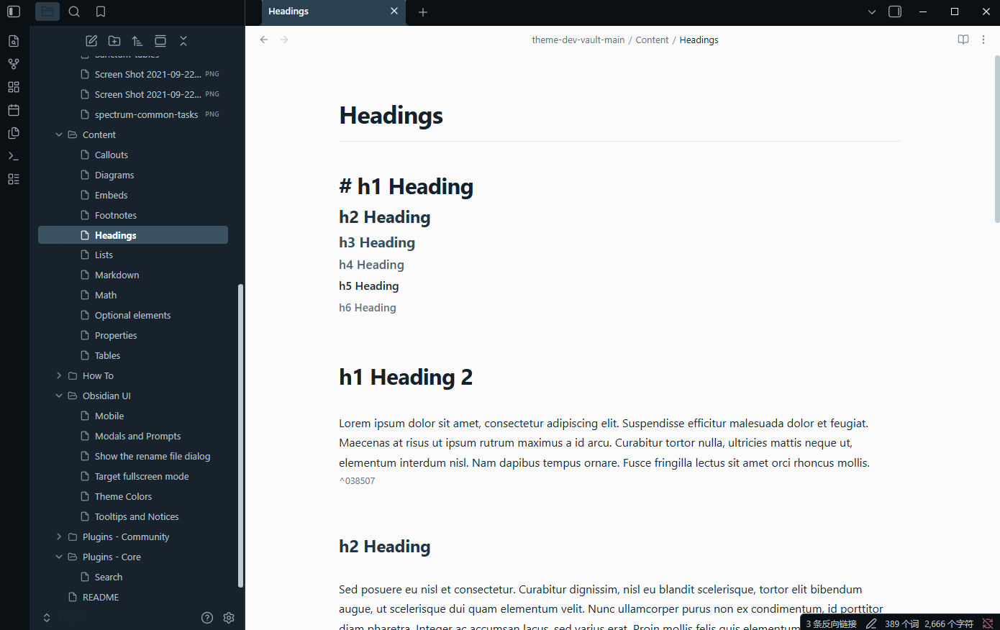
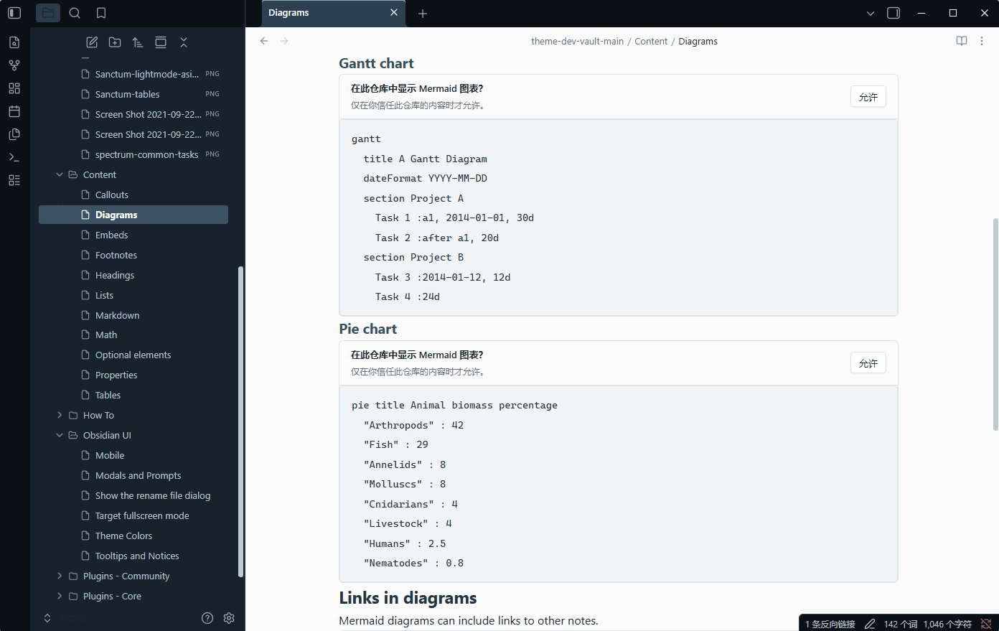

<div align="center">

# Ink &amp; Linen

**为思绪留一处安静的书写空间。**

深蓝灰的边框，近白色的页面，舒展的留白。

[English](README.md) · **简体中文**

[外观预览](#外观预览) · [设计细节](#设计细节) · [安装方式](#安装方式)

</div>

---

Ink & Linen 是一款专注阅读、写作与笔记整理的 Obsidian 主题。深色导航区环绕明亮的书写页面，冷调墨色文字、舒展的间距与清晰的标题层级，让内容成为视觉中心。

## 外观预览

<p align="center">
  
  <br>
  <sub>清晰的层级，舒展的页面，安静的书写空间。</sub>
</p>

## 设计细节

| 安静的工作区 | 清晰的书写页面 | 克制的细节 |
| :--- | :--- | :--- |
| 深蓝灰色侧栏、深色标签栏与柔和的蓝色强调。 | 近白色背景与墨色正文，标题到段落的层级自然分明。 | 细线边框、小圆角，以及风格统一的表格、引用、代码块和提示块。 |

### 配色

| | 色值 | 用途 |
| :--- | :--- | :--- |
| **Night · 夜色** | `#0B1015` | 外围界面与标签栏 |
| **Slate · 青灰** | `#17222D` | 导航区与侧栏 |
| **Linen · 素白** | `#FBFBFC` | 书写页面 |
| **Ink · 墨色** | `#1B2731` | 正文文字 |
| **Blue · 灰蓝** | `#365B75` | 链接、强调与交互 |

### 围绕阅读与写作

- **有节奏的排版。** 六级标题、舒展的行距，以及兼顾中英文的系统字体组合。
- **清楚而克制的导航。** 文件与文件夹图标、明确的选中状态和连贯的深色侧栏。
- **统一的内容样式。** 表格、引用、行内代码、代码块、标签与提示块沿用一致的配色和边框细节。
- **一致的外观。** Obsidian 的浅色和深色设置均采用这套配色：深色导航区搭配浅色正文页面。

<p align="center">
  
  <br>
  <sub>浅色代码面板与细线边框，让技术笔记也保持清楚、整洁。</sub>
</p>

## 安装方式

根据主题清单，**需要 Obsidian 1.13.0 或更高版本**。

1. [下载主题](https://github.com/tail258/Ink-Linen/archive/refs/heads/main.zip)，然后解压。
2. 在你的笔记库中创建 `.obsidian/themes/Ink & Linen/` 文件夹。
3. 将压缩包内的 `theme.css` 和 `manifest.json` 复制到该文件夹。
4. 在 Obsidian 中打开 **设置 → 外观**，从已安装主题中选择 **Ink & Linen**。如果尚未显示，重新启动 Obsidian 后再选择。

目录结构如下：

```text
.obsidian/
└── themes/
    └── Ink & Linen/
        ├── manifest.json
        └── theme.css
```

截图展示的是 Windows 上的主题效果。实际字体会随系统中可用的字体而有所不同。

## 反馈

如果发现样式问题，或有改进建议，欢迎[提交 Issue](https://github.com/tail258/Ink-Linen/issues)，附上 Obsidian 版本、操作系统和相关界面的截图。

## 致谢与许可

Ink & Linen 基于 **Dust & Vellum** 调整，主题样式文件中保留了来源说明。项目采用 [MIT 许可证](LICENSE)，并保留现有版权声明。

---

<div align="center">

*以墨落字，以素留白。*

[English](README.md) · [回到顶部](#ink--linen)

</div>
